# First Person Shooter（UE5 多人联机射击 Demo）

基于 **Unreal Engine 5.7** 第一人称模板开发的多人 FPS 小项目，实现完整的对战循环，涵盖角色控制、武器系统、AI 行为树、网络同步等核心模块。

- **美术资源**：来自官方第一人称模板里自带的美术资源
- **网络模型**：服务端权威，监听服务器
- **游戏逻辑**：全部 C++ 手写（AI、武器、手感、得分、网络同步）
- **对局流程**：主菜单 → 大厅 → 对战 → 结算排名 → 自动重开

> 练手项目，不发布到任何平台。目的是实践 UE5 的多人联机、战斗手感、AI 与完整对局流程，用于技术积累与简历展示。

---

## 功能特性

**战斗**
- 两把武器（步枪 / 手枪），即时命中（Hitscan）
=======
- 两把武器（步枪 / 手枪 ），即时命中（Hitscan）+ 弹道拖尾
- 全自动 / 半自动射速控制，换弹、切枪（带卸下/装备动画）、武器拾取
- 双后坐力：相机后坐力（俯仰/偏航冲击 + 平滑回位）+ 武器网格 kick

**AI**
- `AIPerception` 视觉感知 + `Behavior Tree`，巡逻 / 追击 / 攻击
- 近距离自动检测、目标丢失后的最后已知位置追击

**成长与得分**
- 击杀得分、死亡减半，队伍分 + 个人分
- 击杀奖励：弹药 + 概率触发的回血 / 伤害增益 / 分数增益

**联机与流程**
- 服务端权威：伤害、弹药、生成判定全部在服务端，客户端只做表现
- 玩家死亡自动重生，比赛倒计时，结算排名（前三名），自动重开
- 主菜单 IP 直连（支持 `127.0.0.1` 本机双实例联机），大厅玩家列表
- 支持移动端触控输入（可选）

---

## 技术架构

### 1. 网络同步模型

所有伤害、弹药、生成、计分在**服务端**执行，客户端只做输入上报与表现播放。核心选型：


```
客户端输入 ──(Server RPC)──> 服务端权威逻辑 ──(Spawn / 扣血 / 计分)
                                 │
                ┌────────────────┼────────────────┐
           (Multicast RPC)  (属性复制+OnRep)   (Client RPC)
                │                │                │
          所有客户端特效    客户端状态更新     特定客户端 UI
```

权限判断（贯穿所有逻辑）：

```cpp
HasAuthority()        // 服务端逻辑
IsLocallyControlled() // 本地玩家表现
```

### 2. 武器系统

- **命中判定**：服务端 `LineTrace`（Hitscan），从枪口/相机发射射线，命中即 `ApplyDamage`；本地玩家用相机射线保证准星准确，NPC 从枪口开火
- **射速**：`RefireRate` 控制全自动（计时器连发）与半自动（冷却结束回调）两种模式
- **第一/第三人称双网格**：第一人称网格仅本机可见，第三人称网格本机隐藏，正确呈现其他玩家视角

### 3. 战斗手感（后坐力）

两套独立的后坐力叠加：

| 类型 | 位置 | 实现 |
|------|------|------|
| 相机后坐力 | `AShooterCharacter` | 开火累计俯仰/偏航冲击（带随机散布），停止后按恢复速度平滑回位，期间不恢复 |
| 武器 kick | `AShooterWeapon` | 武器网格向后/向上位移，按冲击时长衰减回静止变换，`Tick` 每帧插值 |

### 4. AI 系统

使用**`AIPerception` + `Behavior Tree`**：

- `AIPerceptionComponent` 配置 Sight Sense（运行时按攻击范围调整视野半径/角度/丢失超时），回调过滤带 `Player` 标签的角色
- `UBTService_UpdatePerception` 按服务间隔更新黑板（目标 Actor、是否在攻击范围、是否有视线）
- `UBTTask_FindPatrolPoint`（随机巡逻）、`UBTTask_FireWeapon`（持续开火）、`UEnvQueryContext_Target`（提供目标上下文）
- 视线检测用 `ECC_Pawn` 通道打射线，避免武器/子弹子 Actor 挡射线；近距离自动检测半径解决"太近无法攻击"

### 5. 增益系统

击杀触发 `GrantKillRewards`（服务端）：

- 固定奖励：所有武器 +1 备用弹匣
- 概率触发：回血（30%）、伤害增益 ×2（30%，10s）、分数增益 ×2（20%，15s）
- 增益提示通过 `Client_ShowBuffMessage` RPC 推送给击杀者，`BuffMessageUI` 显示

### 6. 对局流程与 UI

```
MainMenuUI（IP 直连）──> 对战──>倒计时结束 / EndMatch──>MatchResultOverlay（排名）

```

- `EMatchState`（Lobby / InProgress / Ended）作为 GameState 复制属性驱动各客户端 UI
- 玩家死亡 → `RespawnTime` 计时 → 销毁角色 → PlayerController 检测 Pawn 销毁后重生


---

## 性能与网络同步优化记录

以下记录包含代码调整原因、实现方式和优化前后对比。
### 1. 弹药状态与开火表现分离

**优化前的 Networking Insights：**

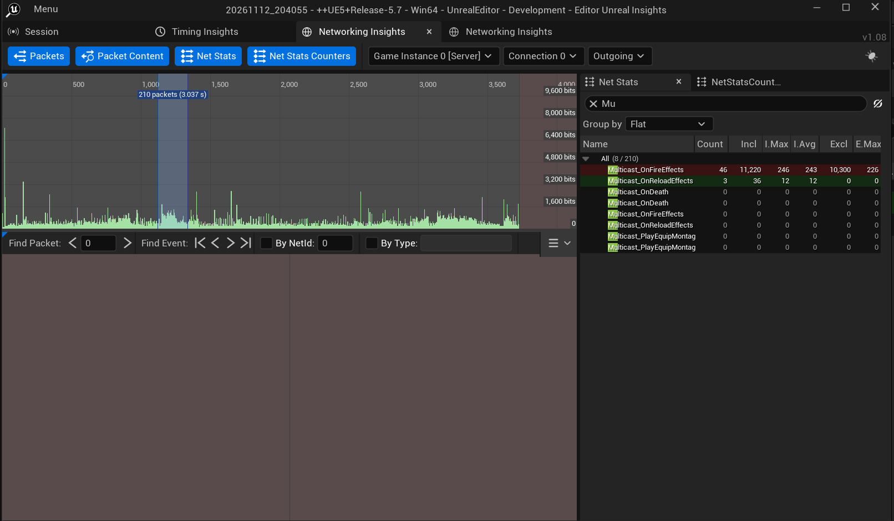

**优化前代码与问题：** `FireProjectile` 把 `CurrentBullets` 和命中点一起传给每次开火的 `Reliable` 多播；接收端再将 `BulletCount` 写回弹药状态并刷新 HUD。弹药是持续状态，每发都随 Reliable RPC 发送会增加状态同步负担。

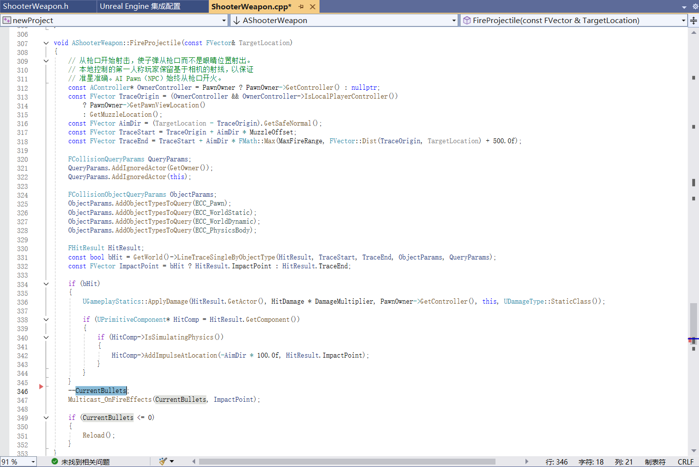

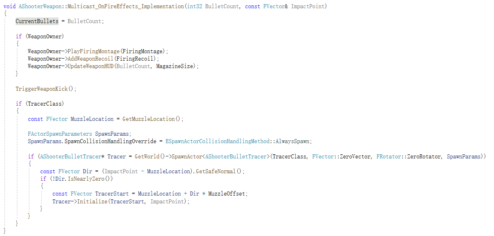

**优化代码：** 将 `CurrentBullets` 声明为 `UPROPERTY(ReplicatedUsing=OnRep_CurrentBullets)` 并通过 `DOREPLIFETIME` 注册，由属性复制同步弹药；`OnRep_CurrentBullets` 更新 HUD。`Multicast_OnFireEffects` 改为 `Unreliable`，只传命中点并播放开火表现。

```cpp
UPROPERTY(ReplicatedUsing=OnRep_CurrentBullets)
int32 CurrentBullets = 0;

UFUNCTION(NetMulticast, Unreliable)
void Multicast_OnFireEffects(const FVector& ImpactPoint);
```

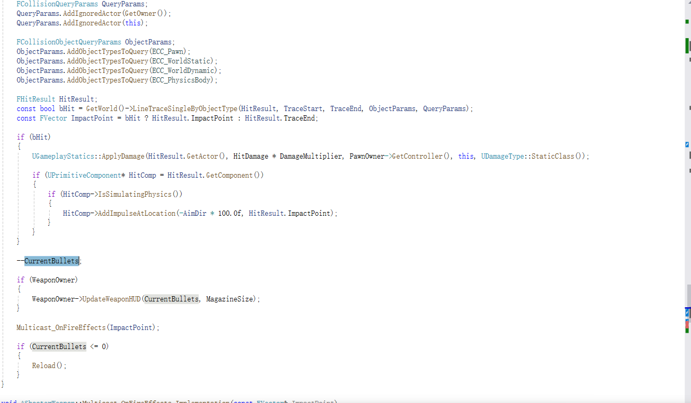

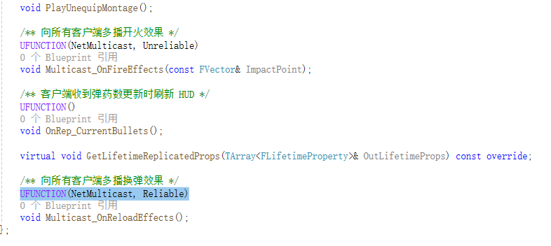

**优化后的 Networking Insights：**

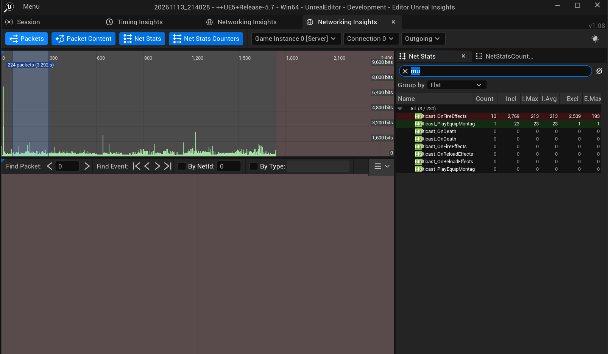

**结果：** 优化前为 3.037 秒内 46 次调用、累计 11,220 bit、平均 243 bit/次；优化后为 3.292 秒内 13 次调用、累计 2,769 bit、平均 213 bit/次。按每秒调用数估算约从 15.1 次降至 3.9 次。

### 2. 全自动瞄准更新 RPC 节流

**优化前的 Networking Insights：**

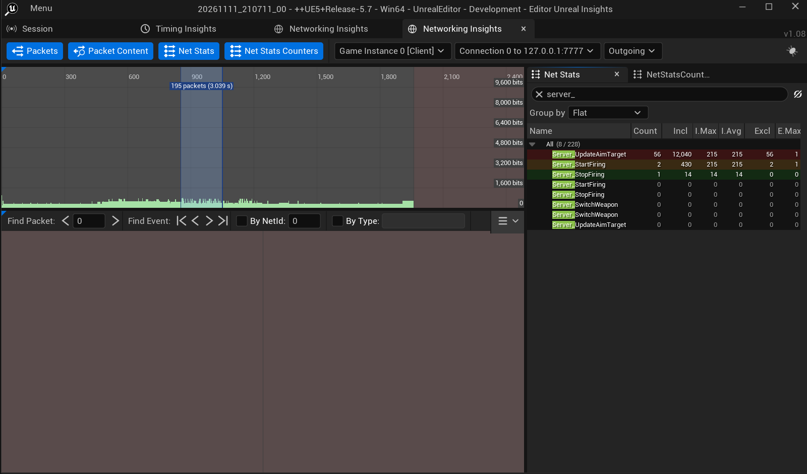

**优化前代码与问题：** `StreamAimTarget()` 每次计时器触发都会调用 `Server_UpdateAimTarget`。全自动时瞄准点持续变化，但服务器收到过于频繁的 RPC。

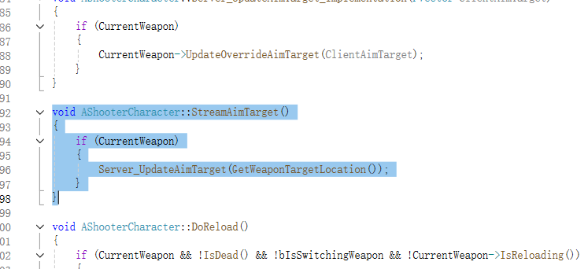

**优化代码：** 使用 `AimTargetUpdateAccumulator` 累计计时器间隔，达到 0.1 秒才发送一次 `Server_UpdateAimTarget`。该 RPC 继续使用 `Unreliable`，因为服务器只需要近期的瞄准位置。

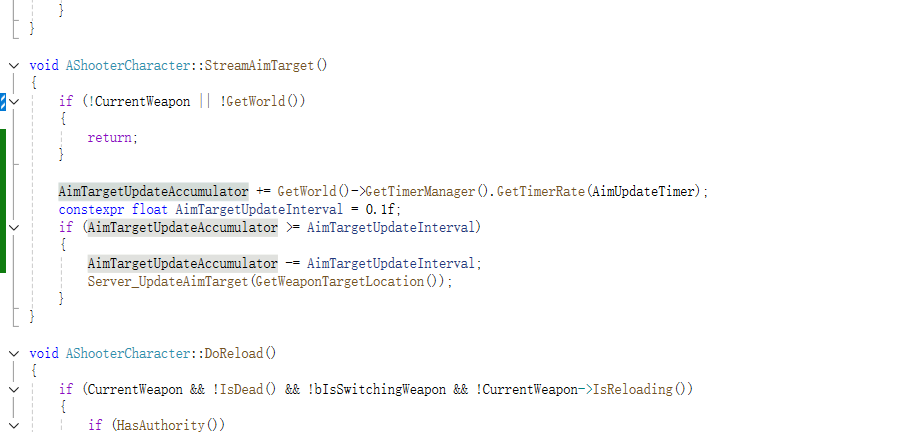

**优化后的 Networking Insights：**

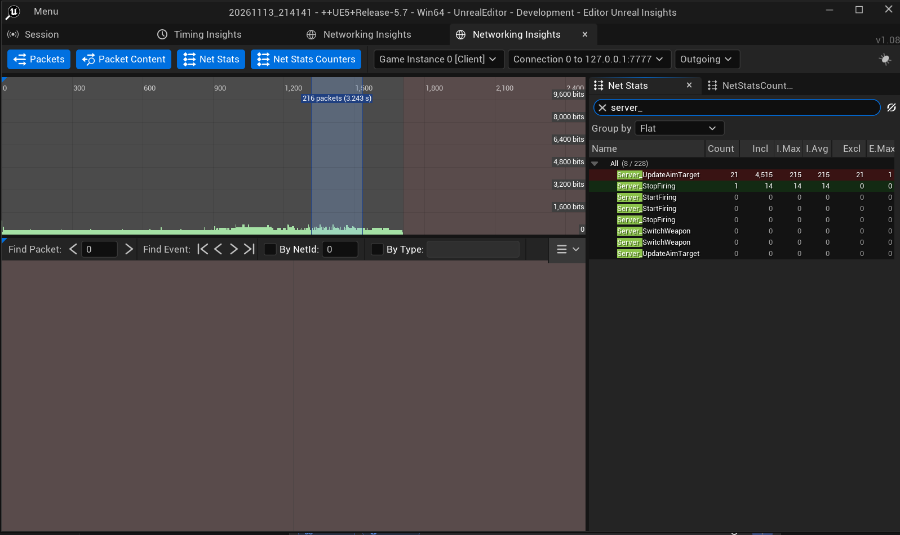

**观测结果：** 旧采样为 3.039 秒内 56 次调用（约 18.4 次/秒、累计 12,040 bit）；新采样为 3.243 秒内 21 次调用（约 6.5 次/秒、累计 4,515 bit）。按每秒调用率估算约下降 65%。

### 3. AI 视线检测：每次行为树更新最多检查一次

**代码分析与问题：** `UBTService_UpdatePerception::TickNode` 在找到感知目标时调用 `HasLineOfSightToTarget()`，写入黑板时又可能再次调用。同一轮 Service 更新因此会对同一目标重复做视线检测。

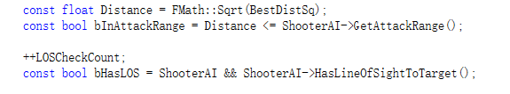

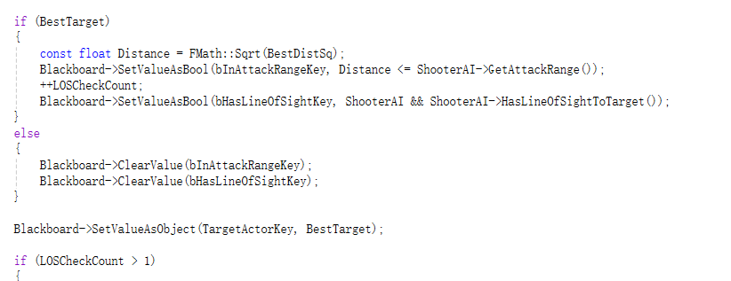

**优化前结果：** 日志截图显示每次 `TickNode` 执行 2 次 LOS 检查。

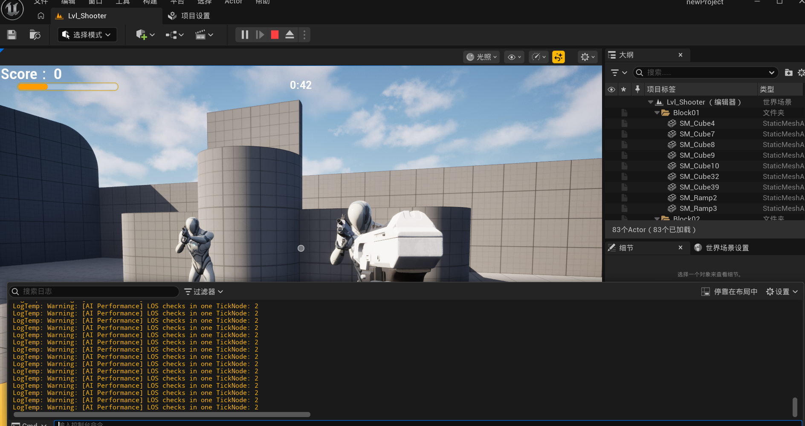

**优化代码：** 在一次 `TickNode` 中缓存 `bHasLOS`，并用 `bHasLOSChecked` 记录是否已检查。写黑板阶段只在本轮尚未检查时补做 LOS 检测。

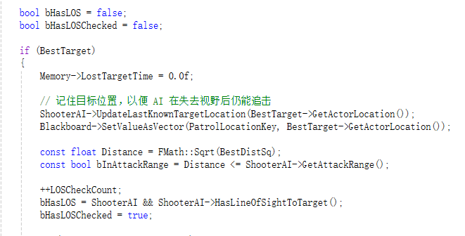

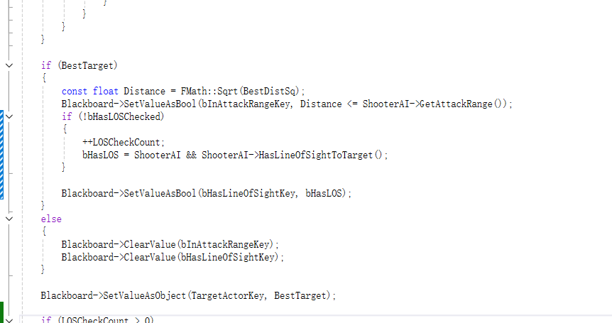

**优化后结果：** 每次 `TickNode` 的 LOS 检查从 2 次降至 1 次，该路径的视线检测调用数减少 50%。

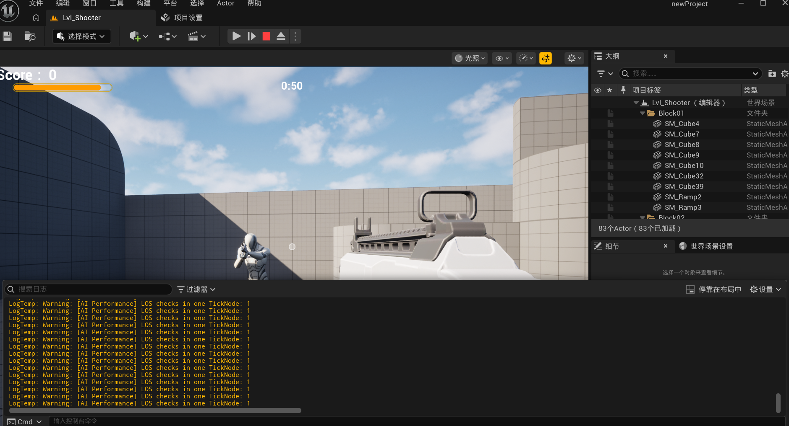

---

## 构建与运行

1. 用 **UE 5.7** 打开 `newProject.uproject`（首次会编译 C++ 并加载蓝图）
2. 默认地图为 `Variant_Shooter/Lvl_Shooter`，默认 GameMode 为 `BP_ShooterGameMode`

**多人联机（监听服务器 / IP 直连）**：

- 主机：主菜单输入本机局域网 IP（或留空），点击连接即可作为主机
- 另一名玩家：输入主机 IP 加入
- 本机双实例调试：两个实例都输入 `127.0.0.1`
